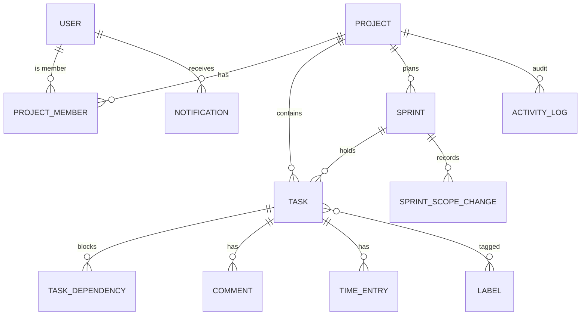

# PMS: Project Management System

A Jira/Trello-like project management system built with **Django, Django REST Framework and
PostgreSQL**, with a server-rendered Bootstrap frontend. The focus is backend correctness:
strict project roles, race-safe numbering, optimistic locking, dependency cycle detection,
sprints with a burndown chart, all proven by tests that run real threads against PostgreSQL.

New to the code? Start with [docs/BEGINNER_GUIDE.md](docs/BEGINNER_GUIDE.md).

## Features
- Projects with roles **owner / manager / member / viewer**; non-members always get 404.
- Tasks with sequential keys (`WEB-1`, `WEB-2`…), labels, filters, search, pagination.
- **Optimistic locking**: a stale edit gets **409 Conflict**, never a silent overwrite.
- Kanban board with drag-and-drop; workflow rules in one place.
- Task dependencies with **cycle detection**; "done" is blocked while a blocker is open.
- Sprints and backlog planning, **one active sprint per project**, burndown and velocity charts.
- Comments with **@mentions**, in-app notifications, idempotent due-soon reminders.
- Time tracking with a 1440-minute daily cap, time reports, workload, dashboard, activity feed.
- REST API with JWT and Swagger; one error format for every error.

## Tech stack
Python 3.11 · Django 5.2 LTS · Django REST Framework · SimpleJWT · drf-spectacular ·
PostgreSQL 17 (psycopg 3) · Bootstrap 5 + vanilla JS + Chart.js (vendored, no build step) ·
Ruff · pip-audit · GitHub Actions.

## Architecture

```
URL -> thin view (API: */api_views.py, pages: */views.py)
    -> projects/permissions.py (who may do what; 404 for outsiders)
    -> services (writes + rules) / selectors (reads)
    -> PostgreSQL (constraints are the last line of defence)
```

Apps: `accounts/`, `projects/`, `tasks/`, `sprints/`, `activity/`, `core/`.
The API and the pages call the same services, so every rule is written once.
Details: [docs/CODE_MAPPING.md](docs/CODE_MAPPING.md).

## Permission matrix

| Action | viewer | member | manager | owner |
|---|---|---|---|---|
| See project, tasks, comments, activity | yes | yes | yes | yes |
| Create/edit/move tasks, comment, log own time, dependencies | no | yes | yes | yes |
| Delete tasks | no | own only | any | any |
| Sprints, labels | no | no | yes | yes |
| Members and roles | no | no | yes (not owners) | yes |
| Archive/delete project, transfer ownership | no | no | no | yes |

## Data model


All tables, constraints and indexes: [docs/DATABASE.md](docs/DATABASE.md).

## Setup (Windows, PostgreSQL, no admin rights)
Full steps, including installing PostgreSQL: [docs/SETUP.md](docs/SETUP.md).

```powershell
python -m venv venv
.\venv\Scripts\python.exe -m pip install -r requirements-dev.txt
copy .env.example .env          # set SECRET_KEY and DATABASE_URL
.\venv\Scripts\python.exe manage.py migrate
.\venv\Scripts\python.exe manage.py seed_demo          # demo users and project (idempotent)
.\venv\Scripts\python.exe manage.py createsuperuser    # optional, for /admin/
.\venv\Scripts\python.exe manage.py runserver
```

Open http://127.0.0.1:8000/ and log in as `demo_owner`, `demo_manager`, `demo_member` or
`demo_viewer` (password `demo-pass-2026`, local demo only).

Environment variables: `SECRET_KEY`, `DEBUG`, `ALLOWED_HOSTS`, `CSRF_TRUSTED_ORIGINS`,
`DATABASE_URL`, throttle rates, production security switches. See `.env.example`.

## Tests

```powershell
.\venv\Scripts\python.exe -W error::DeprecationWarning manage.py test --noinput     # 273 tests
.\venv\Scripts\python.exe manage.py test --tag concurrency --noinput                 # race tests only
.\venv\Scripts\ruff.exe check .
```

The concurrency suite (8 tests with real threads) passed **20 runs in a row**. Also covered: every
cell of the permission matrix, automatic IDOR sweeps over every API and page URL, exact query
budgets, security settings, and a docs check that fails if a documented file or function doesn't exist.

## API
Swagger UI: http://127.0.0.1:8000/api/docs/ · schema: `/api/schema/`.

| Area | Endpoints |
|---|---|
| Auth | `POST /api/auth/register/`, `login/`, `refresh/`, `logout/`; `GET /api/auth/me/` |
| Projects | `/api/projects/`, `/api/projects/<id>/` (+ `archive/`, `transfer-ownership/`, `dashboard/`, `activity/`) |
| Members | `/api/projects/<id>/members/`, `/members/<member_id>/` |
| Tasks | `/api/projects/<id>/tasks/` (filters), `/tasks/<n>/` (PATCH needs `version`), `/tasks/<n>/move/`, `/board/`, `/labels/` |
| Dependencies | `POST /tasks/<n>/dependencies/`, `DELETE /tasks/<n>/dependencies/<blocker>/` |
| Sprints | `/sprints/`, `/sprints/<id>/` (+ `start/`, `complete/`, `tasks/`, `burndown/`), `/velocity/`, `/backlog/` |
| Comments & time | `/tasks/<n>/comments/`, `/tasks/<n>/time/`, `/time/<entry_id>/`, `/reports/time-by-task|time-by-user|time-by-sprint|workload/` |
| Me | `/api/my-tasks/`, `/api/notifications/` (+ `unread-count/`, `read-all/`, `<id>/read/`) |

Errors always look like `{"code": "version_conflict", "detail": "...", "details": {...}}`.

## Hard problems solved
- **Race-safe task numbering**: project row lock + counter → [docs/CONCURRENCY.md](docs/CONCURRENCY.md)
- **Optimistic locking**: `UPDATE … WHERE version = v`, 409 on conflict → [docs/LOGIC.md](docs/LOGIC.md)
- **Dependency cycle detection**: BFS under the project lock → [docs/WALKTHROUGH.md](docs/WALKTHROUGH.md)
- **Sprint rules**: one active sprint (lock + partial unique index), atomic completion → [docs/LOGIC.md](docs/LOGIC.md)
- **Burndown formula**: scope changes + timezone-correct daily sums → [docs/LOGIC.md](docs/LOGIC.md)

## Screenshots
Coming soon: board, task detail, backlog, sprint burndown and members.

## Documentation
[Beginner guide](docs/BEGINNER_GUIDE.md) · [Setup](docs/SETUP.md) ·
[Code mapping](docs/CODE_MAPPING.md) · [Decisions](docs/DECISIONS.md) · [Logic](docs/LOGIC.md) ·
[Concurrency](docs/CONCURRENCY.md) · [Database](docs/DATABASE.md) · [Walkthrough](docs/WALKTHROUGH.md) ·
[Glossary](docs/GLOSSARY.md)
