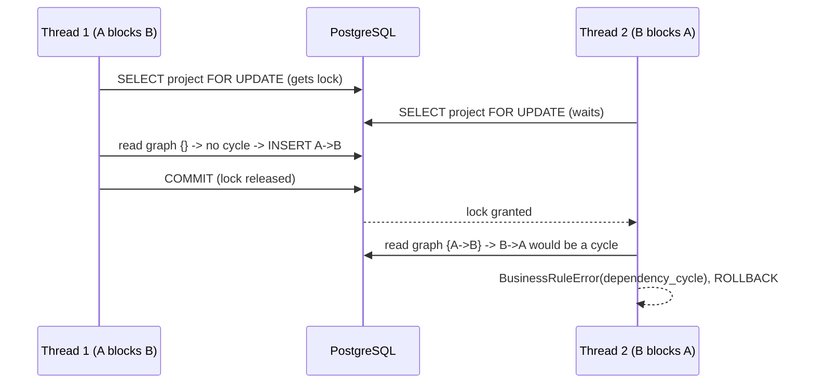
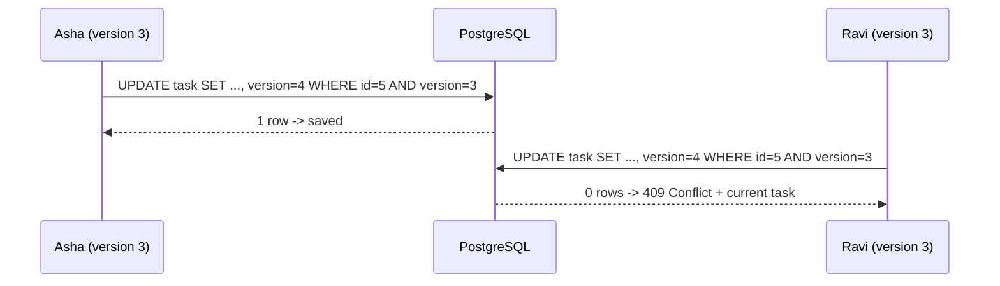

# CONCURRENCY: locks and what each test proves

## Strategy

1. **Pessimistic lock on the project row** (`projects/services.py::lock_project_and_recheck`):
   `SELECT ... FOR UPDATE` on `projects_project`. Every project-level write takes it first, so writers
   of the same project run one after another. Different projects never wait for each other.
2. **Re-check after the lock**: the actor's membership is read again, so a role change committed a
   moment ago is respected.
3. **Optimistic locking for task content** (`tasks/services.py::_apply_versioned_update`):
   `UPDATE ... WHERE id=? AND version=?` + rows-affected check → 409 on mismatch.
4. **User row lock** for the daily time cap (`tasks/time_services.py::_ensure_daily_limit`), because
   the cap spans projects.
5. **Database constraints as the last line**: unique `(project, number)`, unique dependency pair,
   `blocker != blocked`, partial unique "one active sprint per project", partial unique
   "one due-soon reminder per task, user and day", unique project key.

## Tests

All use `TransactionTestCase`, real threads started together by a `threading.Barrier`, and each
thread closes its own DB connection (`core/testing.py::run_concurrently`). All are tagged
`concurrency`: `manage.py test --tag concurrency`.

| # | Test | Proves |
|---|---|---|
| 1 | `tasks/tests/test_concurrency.py::TaskNumberingConcurrencyTests` | 20 parallel creates → numbers exactly 1..20, counter = 20 |
| 2 | `tasks/tests/test_concurrency.py::DependencyConcurrencyTests` | A→B and B→A in parallel → one edge, the other gets `dependency_cycle` |
| 3 | `sprints/tests/test_concurrency.py::SprintStartConcurrencyTests` | two sprints started at once → exactly one active (DB constraint tested directly in `sprints/tests/test_sprints_api.py`) |
| 4 | `projects/tests/test_concurrency.py::LastOwnerConcurrencyTests` | two owners demoting/removing each other → one succeeds, an owner remains |
| 5 | `tasks/tests/test_concurrency.py::OptimisticLockingConcurrencyTests` | same version from two threads → one save, one `VersionConflict`, no lost update |
| 6 | `activity/tests/test_concurrency.py::DueSoonConcurrencyTests` | three parallel `notify_due_tasks` runs → exactly one reminder per task |
| + | `tasks/tests/test_concurrency.py::DailyTimeLimitConcurrencyTests` | two parallel 800-minute entries in two projects → only one saved |

**Repeat run (Phase 12):** the whole concurrency suite (8 tests) ran **20 times in a row with 0 failures**.
No sleeps or retries are used anywhere in tests.

Why test 4 is safe twice over: thread 2 waits for the lock; after thread 1 commits, thread 2
re-reads its own membership (now manager → `PermissionDenied`, or removed → 404). Even without that,
`_ensure_another_owner_exists` would see a single owner and refuse.
