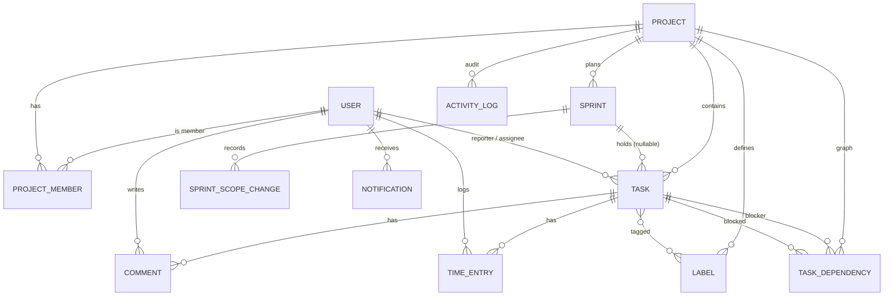

# DATABASE: tables, relations, constraints, indexes

PostgreSQL 17 only. Every primary key is a `BigAutoField`. Migrations live in each app's
migrations folder, for example `tasks/migrations/`.

| Table (model) | Important columns | Constraints / indexes |
|---|---|---|
| `accounts_user` (`User`) | username, email, display_name | unique `lower(email)`, unique username |
| `projects_project` (`Project`) | name, key, status, task_counter | unique key; check `key ~ '^[A-Z]{2,6}$'` |
| `projects_projectmember` (`ProjectMember`) | project, user, role | unique (project, user); index (user, project) |
| `tasks_task` (`Task`) | project, number, title, status, priority, reporter, assignee, due_date, story_points, estimate_minutes, sprint, position, completed_at, version | unique (project, number); check completed_at ⇔ done; indexes (project, status, position), (project, assignee), (project, due_date); FK index on sprint |
| `tasks_label` (`Label`) | project, name, color | unique (project, lower(name)); check color `#RRGGBB` |
| `tasks_task_labels` | task, label | many-to-many |
| `tasks_taskdependency` (`TaskDependency`) | project, blocker, blocked | unique (blocker, blocked); check blocker ≠ blocked; deleted with the task |
| `tasks_comment` (`Comment`) | task, author, body, created_at, edited_at, is_deleted | index (task, created_at) |
| `tasks_timeentry` (`TimeEntry`) | task, user, minutes, date, note | check 1 ≤ minutes ≤ 1440; indexes (user, date), (task, date) |
| `sprints_sprint` (`Sprint`) | project, name, goal, start_date, end_date, status, committed_points, completed_points, started_at, completed_at | check start ≤ end; **partial unique (project) WHERE status = 'active'**; index (project, status) |
| `sprints_sprintscopechange` (`SprintScopeChange`) | sprint, task (nullable), task_number, kind, points, at | index (sprint, at) |
| `activity_activitylog` (`ActivityLog`) | project, actor, verb, target_type, target_id, changes (JSON) | indexes (project, -created_at), (project, target_type, target_id, -created_at) |
| `activity_notification` (`Notification`) | user, project, type, message, link, task, for_date, read_at | index (user, read_at); **partial unique (user, task, for_date) WHERE type = 'due_soon'** |
| `token_blacklist_*` | SimpleJWT tables | used by logout and refresh rotation |

## Why these constraints matter
- Constraints are the last line of defence: even code that bypasses a service cannot create a
  duplicate task number, a second active sprint, a self-dependency or a duplicate reminder.
- Partial unique indexes ("unique only when status is active") are a PostgreSQL feature this
  project depends on; this is one reason SQLite is not allowed.
